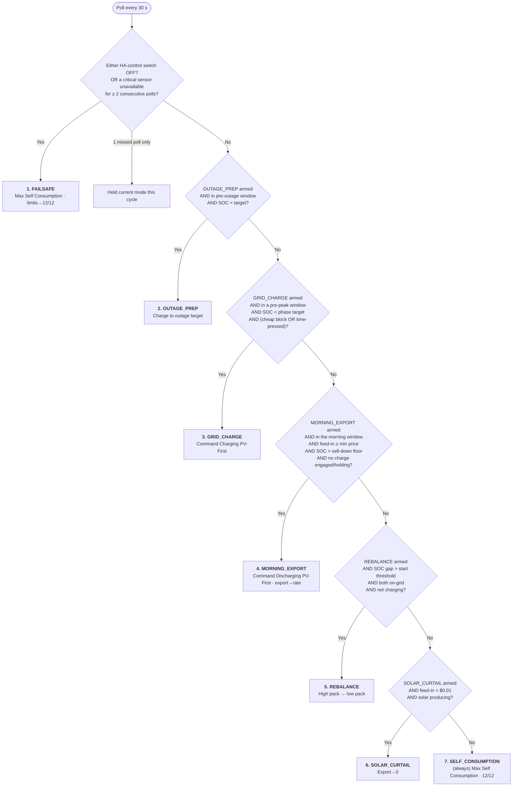

# Sentinel — Control Logic & Decision Tree

How Sentinel decides what to do every 30 s, and exactly which Sigen controls it
writes in each mode. Companion to `CLAUDE.md` (architecture), `OPTIMISATION_PLAN.md`
(the self-running design) and `ISSUES.md` (field faults). Source of truth:
`custom_components/sentinel/coordinator.py` + `learning.py` + `const.py`.

> **Redesigned July 2026** (branch `feature/self-running-optimisation`). The stack
> dropped from 8 modes to 6: **SPIKE_EXPORT** and **MORNING_FLOOR** were removed,
> and **GRID_CHARGE** became a single self-tuning two-peak charger whose targets
> are *learned* and whose deadline is the *detected* price-peak onset.
>
> **September 2026:** **MORNING_EXPORT** added as priority 4 (§4b) — sells the
> pack down into a high morning feed-in price, floored by the learned morning
> load, so the day's solar has somewhere to go instead of being exported at
> midday's negative prices. Stack is back to **7 modes**.

---

## 1. The controls Sentinel drives

The four Sigen actuators Sentinel writes to, per plant (S1 = Plant 1 `.82`,
S2 = Plant 2 `.79`). Sentinel never touches anything else, and **must never**
touch `switch.sigen_plant_*_plant_power`.

| Entity | What it does | Sentinel uses it to… |
|---|---|---|
| `select.…remote_ems_control_mode` | battery operating mode | switch between self-use, forced charge, forced discharge |
| `number.…grid_import_limitation` | max grid **import** power (0–12 kW) | set grid-charge rate; `0` = block import |
| `number.…grid_export_limitation` | max grid **export** power (0–12 kW) | set discharge/export rate; `0` = curtail solar |
| `number.…ess_backup_state_of_charge` | blackout reserve SOC | *(no longer written — MORNING_FLOOR removed)* |

Two **authority switches** sit upstream:
- `switch.sigen_plant_*_remote_ems_controlled_by_home_assistant` — the Sigen's own
  "let HA drive me" switch. **If either is off, Sentinel drops to FAILSAFE.**
- `switch.sentinel_*_enabled` — Sentinel's per-mode arming switches (Grid Charging,
  Rebalancing, Solar Curtail, Outage Prep). **All default OFF.**

### Write pacing — never flood a dongle

Every Modbus-backed write routes through `_paced_service_call`: consecutive
writes are **≥0.4 s apart** (`WRITE_MIN_GAP_SECONDS`) and each is **awaited to
completion** before the next, so a mode change touching several controls trickles
out one command at a time. Writes that are a no-op (already within
`WRITE_TOLERANCE` of the target) or aimed at an unreachable plant
(`_plant_is_reachable_for`, gated on the plant's SOC sensor) are skipped — so
steady state issues **zero** Modbus writes.

---

## 2. The decision tree

Every 30 s the coordinator evaluates a fixed **priority stack** — first mode whose
trigger is true wins, and only that mode writes controls this cycle.

---

## 3. What each mode writes to the controls

Blank = left untouched. "12/12" = import 12 kW + export 12 kW (full inverter).

| # | Mode | EMS mode | Import limit | Export limit |
|---|---|---|---|---|
| 1 | **FAILSAFE** | Max Self Consumption | 12 kW | 12 kW |
| 2 | **OUTAGE_PREP** | Command Charging (PV First) | charge-rate split¹ | 12 kW |
| 3 | **GRID_CHARGE** | Command Charging (PV First) | charge-rate split¹ | 12 kW |
| 4 | **MORNING_EXPORT** | Command Discharging (PV First) | 12 kW | export-rate split³ |
| 5 | **REBALANCE** | high→Discharging PV-First, low→Charging PV-First | high `0` / low rate² | high rate / low `0`² |
| 6 | **SOLAR_CURTAIL** | Max Self Consumption | 12 kW | **0 kW** |
| 7 | **SELF_CONSUMPTION** | Max Self Consumption | 12 kW | 12 kW |

¹ **Charge-rate split** — total `grid_charge_rate_kw` split across the plants,
biased toward the lower-SOC pack (`share = 0.5 + gap/200`), so charging also
nudges the packs together and REBALANCE needn't fire.

² **Rebalance** — higher-SOC plant discharges (export = transfer rate, import 0);
lower-SOC plant charges (import = transfer rate, export 0). Nets to ≈0 at the
single meter, so only round-trip loss is paid.

³ **Export-rate split** — total `morning_export_rate_kw` split across the plants,
biased toward the *higher*-SOC pack (`share = 0.5 + gap/200`), the mirror of the
charge split, so selling also pulls the packs together. Import stays at 12 kW:
the sell-down *floor* is what keeps us off the grid, and clamping import to 0
would turn an unexpected load spike into a brownout rather than a small,
deliberate purchase.

**Restore-on-exit** (only on a clean mode *change*): leaving GRID_CHARGE /
OUTAGE_PREP / MORNING_EXPORT restores all grid limits to 12/12.

---

## 4. GRID_CHARGE — the self-tuning two-peak charger

At any time there is one *next peak* to prepare for. GRID_CHARGE detects it, picks
a target learned from your own usage, and charges to it — solar first, cheap grid
second — completing **before** the peak-price period begins.

### 4a. Deadline = the price jump, detected (`_detect_peak_onset`)

Not a fixed clock hour. Each cycle, from the Amber forecast:
- baseline = 30th-percentile (`PEAK_DETECT_BASELINE_PCTL`) of the forecast prices;
  an interval is **peak** when `per_kwh ≥ baseline × 1.4` (`PEAK_DETECT_FACTOR`) or
  Amber's `descriptor` is high/spike.
- **onset** = the *start of a sustained peak run* (previous interval not peak, next
  interval peak) occurring after now, within its band:
  **morning** `04:00–11:00`, **evening** `13:00–21:00`.
- Fallbacks with no forecast: **06:00** (morning) / **16:00** (evening).

This is why the evening "be charged by" time auto-shifts later in summer — it
follows the tariff jump the forecast already shows. Exposed as
`sensor.…next_morning_peak` / `…next_evening_peak`.

### 4b. Which window we're in (`_resolve_charge_phase`)

- **Daytime window:** `[09:00 on the evening peak's day, evening_onset)` → daytime phase.
- **Overnight window:** `[22:00 the evening before the morning peak, morning_onset)` → overnight phase.
- Otherwise (inside a peak, or between windows) → **not a charge window**, idle.

### 4c. Targets are learned & seasonal (`learning.py`)

The `LoadLearner` integrates the combined load reading each cycle into three daily
windows and keeps a **trailing 14-day average**, persisted via Store. Until a full
day exists it uses seeds (`DEFAULT_SEED_*_KWH`) that reproduce the old fixed
behaviour. Capacity = 2 × `battery_capacity_kwh` (49 kWh).

- **Evening target** (`_compute_grid_charge_target`)
  `= clamp(learned_evening_load / capacity × 100, min_reserve, max_charge)`.
  Dark winter evenings learn a bigger load → higher target; light summer evenings → lower.
- **Overnight cap** (`_compute_overnight_target`)
  `floor = learned_morning_load as SOC` (guarantees the morning peak is covered);
  `ceiling = max_charge`;
  `cap = ceiling − (coming_day_Solcast − learned_daytime_load) as SOC`, clamped
  `[floor, ceiling]`. High-load / winter → ~0 surplus → charge to the ceiling;
  sunny / low-load → cap pulled down so daytime solar fills the pack for free.
  No Solcast → charge to the ceiling to be safe.
  **Coming day = the day that dawns *after* this charge** (`_overnight_solar_kwh`):
  the overnight window straddles midnight (22:00 → morning peak), so before
  midnight the refill day is *tomorrow*'s Solcast, but from midnight onward the
  morning peak is later *today*, so it reads *today*'s Solcast. Decided from the
  date of the morning-peak onset the cap is charging toward; falls back to the
  other Solcast entity if the preferred one isn't wired up.

Only two SOC knobs remain: `grid_charge_min_reserve_soc` (20%) and
`grid_charge_max_soc` (90%). Effective targets are shown by
`sensor.…evening_target_soc` / `…overnight_target_soc`.

### 4d. When it actually charges

1. Hysteresis: don't start until `grid_charge_hysteresis_soc` (3%) below target.
2. `required_hours = deficit_kWh / effective_charge_rate × GRID_CHARGE_TIME_MARGIN`
   (1.3). The margin is deliberate slack: arriving at the peak short costs peak
   prices for the shortfall, while starting early costs at most a little
   off-peak energy.
3. `effective_charge_rate` = **the lower of** the modelled and the *measured*
   rate, floored at `GRID_CHARGE_MIN_EFFECTIVE_KW` (0.5 kW):
   - **modelled** = `grid_charge_rate_kw + PV − load`. The Sigen
     `grid_import_limitation` caps *total* grid import (load + battery) and PV
     First diverts PV into the pack, so the battery fills at rate + PV − load,
     not the raw rate.
   - **measured** = `_observed_charge_kw`, an EMA of ΔSOC/Δt sampled every cycle
     while charging (`_record_charge_rate_sample`). The modelled rate is only an
     upper bound — the plant may not draw the full limit at all. On 2026-08-09 it
     modelled 16 kW while the packs actually took **10.8 kW**, so the window was
     booked at ~half the time it needed and the charge ran out of night.
     Under-estimating just starts the charge earlier; over-estimating misses the
     deadline.
4. **Forced** if `hours_remaining_to_peak < required × GRID_CHARGE_FORCE_FACTOR`
   (1.5) — charge immediately, needs no forecast. Once forced the charge
   **latches to its deadline**: the ratio flickers false as SOC climbs and
   `required` shrinks, which chattered the mode on/off ~40 times in three hours
   before the latch.
5. Otherwise pick the single cheapest **contiguous** block of forecast intervals
   before the deadline (`_select_cheapest_charge_window`); active only while now
   sits in a selected interval. The contiguous block avoids the on/off thrash that
   let REBALANCE steal the gaps.

### 4e. Top-up hold — reaching target early doesn't end the charge

Hitting the target *before* the deadline used to simply stop the charge, after
which household load coasted the pack back down and it met the peak several
percent low (86.5% → 80.0% over the 45 min around the 06:00 peak on 2026-08-09).

Instead, meeting the target **latches a hold to the deadline**
(`_grid_charge_hold_until`). For the rest of the window Sentinel tops the pack
back up whenever it sags `GRID_CHARGE_TOPUP_BAND_SOC` (1%) below target, and runs
the top-up all the way back to target before releasing. So the pack enters the
peak *at* target, and the surplus time between "charged" and "peak" is spent
carrying the house on cheap grid rather than draining the battery it just filled.

Both latches are stamped with the deadline they were set for and released when it
passes (`_expire_charge_latches`), so each phase starts clean; a re-detected onset
that moves less than an hour counts as the same peak and just refines the stamp.

---

## 4b. MORNING_EXPORT — sell the morning surplus, keep the morning cover

**The problem it solves.** On a good solar day the pack comes off the overnight
charge still holding energy at dawn, and by midday the feed-in price has gone
*negative* — so the day's generation has nowhere useful to go. It can't fit in a
full battery and exporting it costs money. Meanwhile the morning feed-in price is
often the best of the day.

**The fix.** While the morning feed-in price is high, discharge to grid — but only
down to a floor that still covers the house until solar takes over, so the morning
never ends up bought back at peak import prices. The room this frees is exactly
the room the day's solar then fills for free.

### The floor (`_compute_morning_export_floor`)

Two independent floors; the **higher** wins, then it is clamped up to
`grid_charge_min_reserve_soc`. Exposed as `sensor.…morning_export_floor_soc`.

1. **Morning cover** — `backup_reserve + (remaining morning load ×
   MORNING_EXPORT_RESERVE_MARGIN)` as SOC. The remaining load
   (`_morning_cover_kwh`) pro-rates the *learned* morning-window kWh across
   however much of the 06–09 band is still ahead — at 05:00 the whole morning is
   still to come, by 08:00 only a third of it — and prices any part of the window
   outside that band at the live load. It never returns less than *current load
   held flat to takeover*, so a morning with the pumps running isn't sized off a
   fortnight's quiet average. This is the "don't import at the morning peak"
   guarantee, and it's why the floor **decays** through the morning.
2. **Evening refill** — `evening_target − (today's Solcast − learned daytime
   load)` as SOC. Don't sell what the sun can't put back: on a dull day the
   surplus is ~0, the floor sits at the evening target, and the mode effectively
   never fires. **No Solcast reading → assume no refill** and hold the whole
   evening target.

Worked example (49 kWh pack, 10% ESS reserve, learned 20/45/40 kWh):

| Day | Solcast | Morning-cover floor | Evening-refill floor | **Effective floor** |
|---|---|---|---|---|
| Sunny | 80 kWh | 59% | 19% | **59%** |
| Average | 55 kWh | 59% | 70% | **70%** |
| Dull | 40 kWh | 59% | 90% | **90%** (no export) |
| No forecast | — | 59% | 90% | **90%** (no export) |

Same sunny day, the floor falling as the morning burns off: 04:30 → 73.7%,
06:00 → 59.0%, 07:00 → 42.7%, 08:00 → 26.3%, 08:45 → 20.0% (min reserve).

### When it fires

All of: armed; local hour in `[MORNING_EXPORT_START_HOUR (04:00),
morning_export_takeover_hour (09:00))`; both plants **On Grid**; live Amber
feed-in ≥ `morning_export_min_price` ($0.15); mean SOC above the floor.

Never while a charge is engaged **or still holding** — `_grid_charge_active` /
`_outage_prep_active`, plus either GRID_CHARGE latch (`_grid_charge_hold_until` /
`_grid_charge_forced_until`) being set while GRID_CHARGE is armed. That last guard
matters: between top-ups the hold reads *inactive*, and without it MORNING_EXPORT
would sell off the very charge GRID_CHARGE just bought to cover the morning peak.
Both latches release when their deadline passes, which is the moment the morning
peak — and its high feed-in price — actually starts.

**Restart band** — once the pack reaches the floor the mode stops; it must recover
`MORNING_EXPORT_RESTART_BAND_SOC` (3%) above the floor before selling resumes, so
SOC sitting on the floor doesn't toggle the mode every 30 s cycle.

**Known trade-off:** the live-load term makes the floor jump when a big load
starts, which pauses the sell-down. That errs toward keeping energy in the pack —
the deliberate bias — but a load oscillating around the threshold can cost a mode
change every few minutes. Widen `MORNING_EXPORT_RESERVE_MARGIN` or lower the
takeover hour if that shows up in the logs.

---

## 5. Other modes — triggers & tunables

| Mode | Fires when | Key knobs (defaults) |
|---|---|---|
| **FAILSAFE** | Either HA-control switch off (immediate), or a critical sensor unavailable ≥ 2 polls (`FAILSAFE_DEBOUNCE_POLLS`) | — |
| **OUTAGE_PREP** | Outage date set; inside `22:00 day-before → 06:00 outage day`; mean SOC < target. Cheapest intervals, or forced if time-pressed | `outage_target_soc` 90%, reuses `grid_charge_rate_kw` |
| **MORNING_EXPORT** | Armed; 04:00 → takeover hour; feed-in ≥ min price; both On Grid; SOC above the sell-down floor; no charge engaged or holding | `morning_export_min_price` $0.15, `morning_export_rate_kw` 10 kW, `morning_export_takeover_hour` 09 *(advanced)* |
| **REBALANCE** | Armed; SOC gap > **10%** start / **3%** stop; both `On Grid`; discharge pack > backup+5%; charge pack < 95%; **suppressed while charging** | start 10%, stop 3%, transfer rate *(advanced)* |
| **SOLAR_CURTAIL** | Armed; Amber feed-in < **$0.01**; combined PV > 0 | price threshold *(advanced)* |
| **SELF_CONSUMPTION** | Always — the fallback | — |

---

## 6. The knobs (Controls panel)

**Switches:** Enable Grid Charging · Enable Rebalancing · Enable Solar Curtail ·
Enable Morning Export · Enable Outage Prep.
**Numbers (primary):** Grid Charge Rate (kW) · Min Reserve % · Max SOC % · Outage
Target % · Morning Export Min Price ($/kWh) · Morning Export Rate (kW).
**Date:** Outage Date.
**Advanced (disabled by default):** Grid Charge Hysteresis Band · Morning Export
Solar Takeover Hour · Solar Curtail Price Threshold · Rebalance Start/Stop
Threshold · Rebalance Transfer Rate.
**Read-only insight sensors:** active mode, mean SOC, learned morning/daytime/
evening load, learning days, effective overnight/evening target, morning export
floor SOC, next morning/evening peak times, plus the daily energy sensors.

---

## 7. Self-consumption, by design

- **Any weather** — overnight cap scales with the Solcast forecast + learned load,
  so summer never fills overnight (leaving room for solar) and winter tops up cheap.
- **Any price** — all charging picks the cheapest Amber intervals; the deadline is
  the real price jump.
- **Room for the day's solar** — MORNING_EXPORT sells the pack down into the high
  morning feed-in price, but only as far as the morning cover allows and only as
  far as the day's forecast solar can put back. The headroom it frees is filled by
  generation that would otherwise have been exported at a negative price.
- **Max solar to loads** — Max Self Consumption routes solar → load → battery; the
  adaptive overnight floor never charges so high that solar has nowhere to go;
  SOLAR_CURTAIL only blocks export when feed-in is worthless. Generated kWh land in
  loads/battery before any export.
